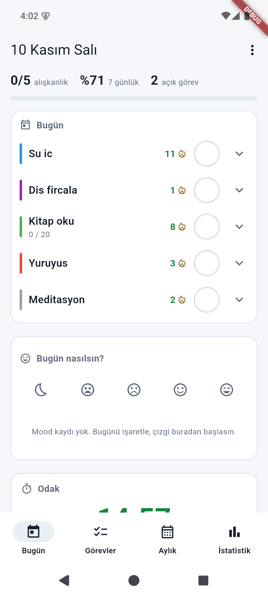
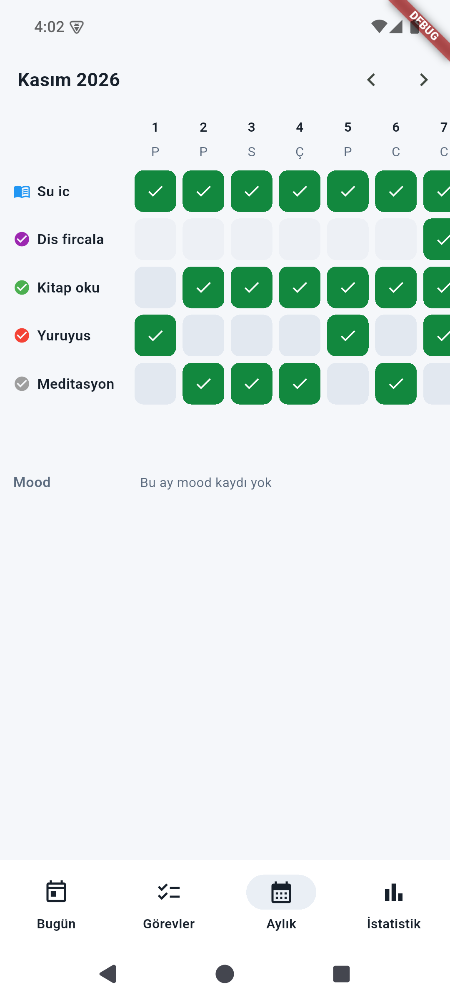
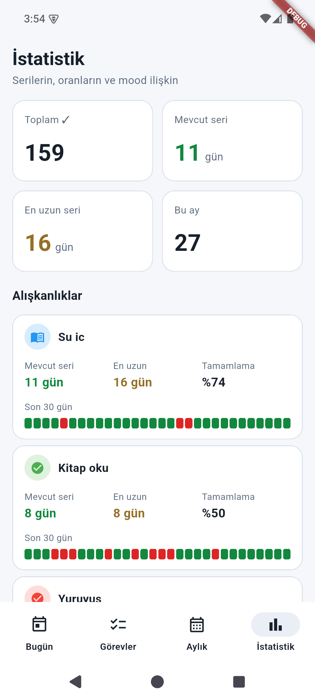
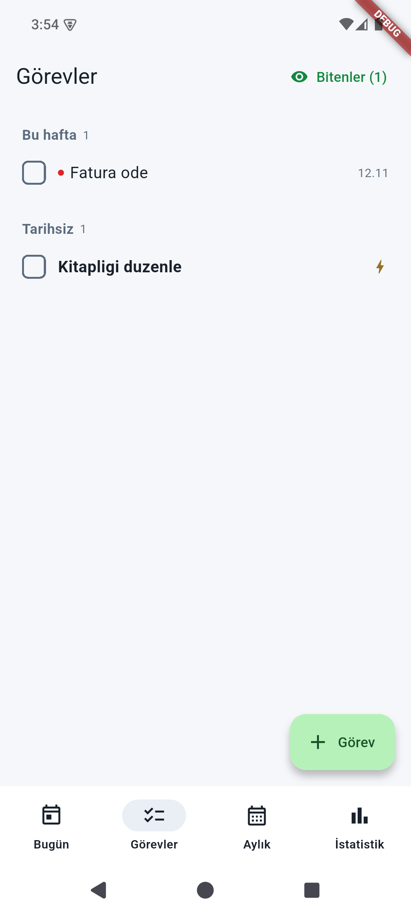
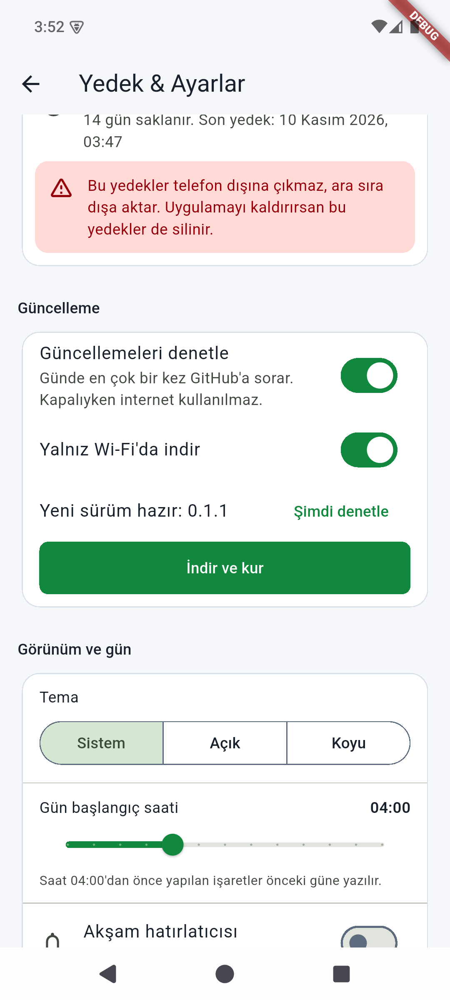
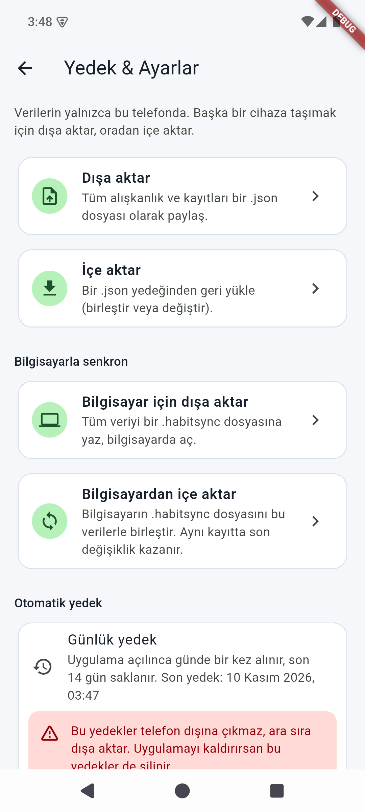
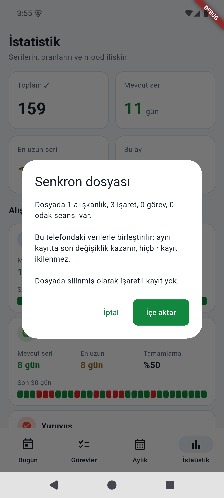

# Habit Tracker Mobil

Aktenak Habit Tracker'ın Android sürümü: hesapsız, internetsiz, verin telefonunda kalır.
Masaüstü sürümü: [tungarix/habit-tracker](https://github.com/tungarix/habit-tracker).

> Durum: **ilk sürüm öncesi (v0.0.1, geliştirme)**. Henüz yayımlanmadı, telefonda denenmedi; plan için [PLAN.md](PLAN.md).

## Özellikler

- **Bugün:** bugünün alışkanlık listesi. Dokundukça ✓ → ✗ → – → boş döner; sayılı alışkanlıkta uzun basınca miktar girilir. Mood, kısa not, açılıp kapanan 30 günlük ısı şeridi, bu haftanın görevleri.
- **Görevler:** aciliyete göre gruplu liste, ekle / düzenle / bitir.
- **Aylık:** alışkanlık x gün tablosu (44 px hücre, yatay kayar, adlar sabit sütunda) ve mood grafiği.
- **İstatistik:** seriler, tamamlama oranları, 30 gün şeridi, mood ile tamamlama ilişkisi.
- **Alışkanlıklar ve Ayarlar** (Bugün ekranının menüsünden): ekle, düzenle, arşivle, sırala, sil; tema (Sistem / Açık / Koyu); gün başlangıç saati; JSON yedeği dışa / içe aktarma (masaüstü yedekleri dahil).
- **Odak sayacı:** bitiş bildirimi tam zamanlı kurulur ve süreç ölse de sayaç kaldığı yerden sürer. Ekran kapalıyken 25 dakikalık sayacın gerçekten zamanında çalması ve bildirimin gelmesi gerçek telefonda DENENMEDİ.
- **Akşam hatırlatıcısı:** önümüzdeki 7 gün için bildirim; bugünün alışkanlıkları tamamsa bugünkü gelmez.
- **Ana ekran widget'ı:** bugünün alışkanlıkları, dokununca ✓ yazar.
- **Otomatik yedek:** açılışta ve uygulama öne gelince günde bir; uygulamanın kendi klasöründe kalır (telefon dışına çıkmaz, uygulama kaldırılınca silinir).
- **Bilgisayarla senkron (taslak, masaüstü v1.4.0 ile birlikte yayımlanacak):** Ayarlar'dan `.habitsync` dosyasını dışa / içe aktar; dosya yöneticisinden ya da Paylaş menüsünden gelen `.habitsync` onay ekranıyla açılır. Çakışmada son değişiklik kazanır, hiçbir kayıt ikilenmez. Kurallar masaüstü reposundaki `docs/senkron.md` dosyasındadır.
- **Bilgisayarla eşitle (QR + Wi-Fi, taslak, yayımlanmadı):** Ayarlar > "Bilgisayarla eşitle". Bilgisayardaki QR okutulur (ya da bağlantı yapıştırılır), telefon yalnız QR'daki sertifika parmak iziyle sabitlenmiş bir bağlantıyla aynı Wi-Fi'daki bilgisayara bağlanır, iki yönde birleştirir. Kamera izni yalnız "QR'ı tara"ya basınca istenir; görüntü kaydedilmez. Tasarım: `docs/faz4/TASARIM.md`, durum: `docs/faz4/rapor-mobil-istemci.md`.
- Erişilebilirlik: durum işaretlerinin `Semantics` etiketleri ve dokunma alanları (Aylık hücreleri hariç: 44 px, plana göre) otomatik testlerle denetlenir. TalkBack ile gerçek cihazda okuma DENENMEDİ.
- Hesap ve bulut yok. İnternet yalnız güncelleme için: Ayarlar'da güncelleme bölümü, ilk açılışta tek seferlik onay, varsayılan yalnız Wi-Fi; indirilen APK kurulumdan önce SHA-256 ile yeniden denetlenir (Kotlin tarafı da özeti doğrular). İmzalı yayın APK'sında sahte GitHub ile uçtan uca deneme henüz YAPILMADI.

## Kurulum

_Yer tutucu: ilk imzalı sürüm yayımlanınca indirme bağlantısı buraya gelecek._

APK yalnız GitHub Release ve aktenak.tech üzerinden dağıtılır (Play Store yok).
Telefonda "bilinmeyen kaynaklardan yükleme" izni gerekir.

Kurulum notları:
- Bildirim izni, ilk hatırlatıcı ya da sayaç açılışında istenir. Android 12'de tam zamanlı alarm izni de gerekir.
- Pil tasarrufu bildirimleri geciktirebilir; hatırlatıcı yaklaşık zamanlıdır (birkaç dakika kayabilir).
- Uygulamayı kaldırmak veriyi siler (`allowBackup=false`); önce Ayarlar'dan dışa aktar.
- Sonraki sürümler veri kaybı olmadan üstüne kurulur.

## Doğrulama

Sertifika SHA-256 parmak izi: _ilk sürümde yazılacak_.
`SHA256SUMS.txt` ile APK doğrulama adımları da ilk imzalı sürümle yazılacak.

## Geliştirme

```
flutter pub get
flutter analyze
pwsh tool/e2e/calistir.ps1     # masaüstü <-> mobil senkron uçtan uca (geçici veritabanları)
pwsh tool/test_calistir.ps1    # testleri dosya dosya çalıştırır (Windows'ta flutter_tester çöker)
```

- Ortak kod masaüstünden kopyalanır: `pwsh tool/esitle.ps1`. Kopyalar elle değiştirilmez;
  `test/uyum_test.dart` ve CI uyum bekçisi bunu denetler. Bilinçli sapmalar `tool/kaynak_ozet.json` içinde gerekçesiyle durur.
- Yerel yayın derlemesi (NDK'sız makinede): `HABIT_YEREL_NDKSIZ=1 flutter build apk --release --target-platform android-arm64`. APK büyük çıkar (~170 MB, yalnız derleme denemesi içindir).
- Yerel debug APK telefona kurulmaz (imzası yayın sürümünden farklı). Yayın APK'sı yalnız CI'dan çıkar.

## Lisans

[MIT](LICENSE)

## Ekran görüntüleri

Emülatörde, uydurma verilerle alındı (`docs/gece-raporu/ekran/`).

| Bugün | Aylık | İstatistik |
|---|---|---|
|  |  |  |

| Görevler | Ayarlar | Güncelleme |
|---|---|---|
|  |  |  |

| Bilgisayarla senkron | Senkron onayı |
|---|---|
|  |  |
